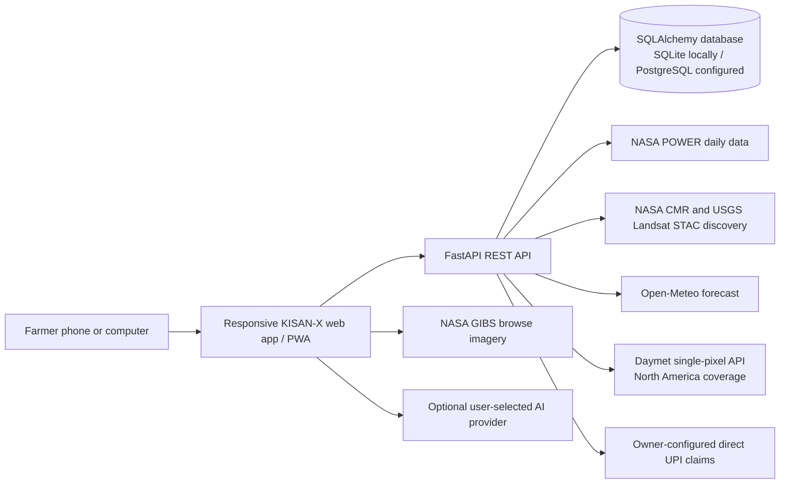

# KISAN-X + KrishiQ

**Farmer-first field intelligence using public Earth-observation and weather data**

**Live demo:** [https://kisanx-api-uxko.onrender.com/](https://kisanx-api-uxko.onrender.com/)  
**API health:** [https://kisanx-api-uxko.onrender.com/health](https://kisanx-api-uxko.onrender.com/health) · **API docs:** [https://kisanx-api-uxko.onrender.com/docs](https://kisanx-api-uxko.onrender.com/docs)

KISAN-X is a responsive web app and FastAPI service for recording farm areas, viewing regional satellite imagery and climate context, checking a coordinate-based weather forecast, and comparing crop-planning options. KrishiQ provides an optional assistant flow that can use a provider API key supplied by the user.

> This README is based on the supplied **NASA Space Apps Challenge – Nagpur 2026 Participant Handbook** and the current repository. The handbook requires the exact challenge prompt, team roster, demo materials, setup instructions, and an AI-usage disclosure. Complete the marked team and challenge fields before submission.

## 1. Project title and problem statement

### Project title

**KISAN-X: Farmer-first Earth intelligence for field decisions**

### Problem addressed

Farmers often need to interpret weather, vegetation, rainfall, and soil-moisture information from separate sources. KISAN-X brings selected public data and farmer-entered field context into one workspace so a user can inspect a location, record an approximate field boundary, and make more informed planning comparisons.

**Official NASA Space Apps challenge title/ID:** `[Add the exact on-site challenge title and ID selected by the team]`  
**How this solution addresses that challenge:** `[Replace this sentence with a short mapping to the official problem statement.]`

The app presents environmental context and planning aids. It does not claim to measure a specific farm's soil nutrients, diagnose a crop, or predict yield.

## 2. Team details

**Team name:** `[Add team name]`

| Member | Full name | Institution | GitHub username | Role |
|---|---|---|---|---|
| 1 | `[Name]` | `[Institution]` | `[@username]` | `[Role]` |
| 2 | `[Name]` | `[Institution]` | `[@username]` | `[Role]` |
| 3 | `[Name]` | `[Institution]` | `[@username]` | `[Role]` |
| 4 | `[Name]` | `[Institution]` | `[@username]` | Backend and integration |
| 5 (optional) | `[Name]` | `[Institution]` | `[@username]` | `[Role]` |

## 3. Solution overview and architecture

The browser app is served by the same FastAPI origin as the JSON API. The API stores farm records and payment claims through SQLAlchemy, and requests external data only when a user asks for it. NASA browse imagery is rendered from NASA GIBS; data-source discovery and numeric observations have separate provenance labels.



### Technology stack

- **Backend:** Python 3.11+, FastAPI, Pydantic, SQLAlchemy, HTTPX, Uvicorn.
- **Database:** SQLite by default for local use; PostgreSQL can be selected with `DATABASE_URL`.
- **Web app:** HTML, CSS, and JavaScript, served by FastAPI; installable PWA shell.
- **Mobile/desktop wrappers:** Capacitor for Android and Tauri for Windows; these use the same web interface and a configured backend origin.
- **External data:** NASA POWER, NASA GIBS, NASA CMR, USGS Landsat STAC, Daymet, and Open-Meteo.
- **Optional AI:** Gemini, OpenAI, Anthropic, or an OpenAI-compatible provider using a key entered by the user.

### Current features in the codebase

- Farm profile create, list, read, and update API; farmer-drawn GeoJSON field outlines with approximate area.
- Interactive map with NASA GIBS browse layers for MODIS Terra, MODIS Aqua, GPM/IMERG, SMAP, Landsat WELD, and Suomi-NPP VIIRS.
- NASA POWER daily gridded historical weather context for a selected coordinate.
- Coordinate-based short-range weather forecast from Open-Meteo.
- Satellite data hub that maps sources to crop-rotation, soil-health, and weather-alert contexts and reports whether a response is numeric, catalog metadata, or unavailable.
- Crop-sequence comparison, scenario comparison, and stored reports. Results depend on the available crop catalogue and supplied inputs.
- KrishiQ chat and speech transcription API routes with optional bring-your-own provider keys; the service does not embed a Gemini or other provider secret.
- Direct owner-configured UPI checkout and manual claim verification; no third-party payment gateway is used.
- Android and Windows wrapper build instructions in [docs/NATIVE_APP_BUILDS.md](docs/NATIVE_APP_BUILDS.md).

### NASA and Earth-observation data: what is connected

The satellite hub registers 13 dataset entries. **A registered source is not automatically a live numerical measurement.** The current implementation distinguishes live numeric responses from catalog discovery and unavailable results, and does not insert synthetic satellite measurements.

| Source | Current integration in this repository | Important limit |
|---|---|---|
| NASA POWER | Live daily point API for weather and radiation parameters | Gridded historical context, not an on-farm sensor or forecast |
| SMAP | NASA CMR granule discovery; GIBS surface/root-zone browse layers | Discovery metadata or browse imagery; no farm-level moisture extraction |
| GPM / IMERG | NASA CMR granule discovery; GIBS precipitation browse layer | Browse imagery is regional precipitation context, not a field rain gauge |
| MODIS Terra and Aqua | Separate dataset entries and GIBS browse imagery | The map does not calculate parcel-level vegetation scores from pixels |
| Landsat 8 and 9 | USGS STAC scene metadata; GIBS Landsat WELD monthly NDVI visualization | No surface-reflectance download, cloud masking, or field NDVI calculation |
| ECOSTRESS | NASA CMR granule discovery | No extracted field temperature or evapotranspiration values |
| GRACE / GRACE-FO | NASA CMR granule discovery | Coarse regional water-storage context, not a farm-well reading |
| Suomi-NPP VIIRS | NASA CMR discovery; GIBS thermal-anomaly browse layer | A mapped anomaly does not prove crop-residue burning on a specific farm |
| NASADEM / SRTM | NASA CMR granule discovery | No field elevation sampling or runoff calculation |
| Daymet | Live numeric single-pixel API where supported | North America coverage; locations in India are out of coverage |
| TEMPO | NASA CMR granule discovery | Coverage is regional; no extracted field air-quality measurement |

For the India-focused workflow, NASA POWER is the hub's live numeric climate source. GIBS can display browse imagery from six represented platform/source groups—Terra, Aqua, GPM, SMAP, Landsat, and Suomi-NPP—but these rendered layers are not parcel-clipped analysis. Provider latency, cloud cover, coverage, and internet access affect availability.

## 4. Live demo and screenshots

- **Hosted application:** [KISAN-X on Render](https://kisanx-api-uxko.onrender.com/)
- **API health endpoint:** [ `/health` ](https://kisanx-api-uxko.onrender.com/health)
- **Interactive API reference:** [ `/docs` ](https://kisanx-api-uxko.onrender.com/docs)
- **Demo video:** `[Add a public demo-video link, if available]`
- **Screenshots:** `[Add screenshots captured from the running app to this repository before submission]`

The Render service is currently on the free plan. The Render control plane reported a live deploy when this README was prepared; opening the links and checking the key flows before a presentation is still required. Free services can have cold starts, and external data providers can be temporarily unavailable.

## 5. Installation and setup

### Run the web app and backend locally

Requirements: Python 3.11 or newer.

**Windows PowerShell**

```powershell
py -3.11 -m venv .venv
.\.venv\Scripts\Activate.ps1
python -m pip install --upgrade pip
pip install -r backend/requirements.txt
Copy-Item .env.example .env
Set-Location backend
python -m uvicorn app.main:app --reload --host 127.0.0.1 --port 8000
```

**macOS / Linux**

```bash
python3 -m venv .venv
source .venv/bin/activate
python -m pip install --upgrade pip
pip install -r backend/requirements.txt
cp .env.example .env
cd backend
python -m uvicorn app.main:app --reload --host 127.0.0.1 --port 8000
```

Open [http://127.0.0.1:8000/](http://127.0.0.1:8000/) for the app and [http://127.0.0.1:8000/docs](http://127.0.0.1:8000/docs) for the API reference. The default local database is SQLite. The `.env` file belongs in the repository root; keep it private and never commit it.

### Configuration

The safe development defaults are in `.env.example`. Common settings include:

| Variable | Purpose |
|---|---|
| `DATABASE_URL` | SQLite or PostgreSQL connection string |
| `CORS_ORIGINS` | Browser/native app origins allowed to call the API |
| `NASA_POWER_TIMEOUT_SECONDS`, `NASA_POWER_CACHE_TTL_SECONDS`, `NASA_POWER_RETRIES` | NASA POWER request behavior |
| `KISANX_OWNER_PIN` | Secret PIN for owner payment routes; configure only on the backend |
| `KISANX_OWNER_EMAIL` | Email allowlist for the owner dashboard; email does not replace the PIN |
| `KISANX_ENABLE_PUBLIC_PAYMENT_CLAIMS` | Public claim submission toggle; disabled by default |

AI provider keys are entered by the user in the app and sent for the individual request in `X-Provider-API-Key`; the backend does not persist them. Do not place provider keys, owner PINs, database credentials, personal farm data, or payment proof files in source control or a mobile app build.

### Useful API routes

All routes other than the satellite hub are under `/api/v1`.

| Method | Path | Purpose |
|---|---|---|
| GET | `/health` | Service health |
| GET, POST | `/api/v1/farms` | List or create farm records |
| GET, PATCH | `/api/v1/farms/{farm_id}` | Read or update a farm |
| GET | `/api/v1/farms/{farm_id}/observations` | NASA POWER daily observations for a saved farm |
| GET | `/api/v1/nasa/power?lat=…&lon=…` | NASA POWER data for a coordinate |
| GET | `/api/v1/weather/forecast?lat=…&lon=…` | Coordinate-based forecast from Open-Meteo |
| GET | `/api/v1/earth-observation/catalog` | NASA GIBS browse-layer catalogue |
| POST | `/api/v1/earth-observation/sentinel-2/search` | Sentinel-2 scene metadata search for a boundary |
| GET | `/api/satellites/sync-all?latitude=…&longitude=…` | Query the dataset hub and return source status/provenance |
| POST | `/api/satellites/query-feature` | Map sources to a crop, soil, or weather feature |
| POST | `/api/v1/rotations/compare` | Compare crop sequences |
| POST | `/api/v1/simulations` | Compare a baseline with a hypothetical scenario |
| POST | `/api/v1/ai/chat` | Optional user-key AI chat |
| POST | `/api/v1/ai/transcribe` | Optional provider-backed speech transcription |
| GET | `/api/v1/owner/dashboard` | Owner dashboard; requires owner PIN and configured email |

See [docs/api-contract.md](docs/api-contract.md) for request and response details. The full interactive schema is available at `/docs`.

## Data boundaries and safety

- NASA gridded products describe an area around a coordinate, not direct measurements taken on the farm.
- GIBS layers are browse visualizations. The map does not derive field boundaries from satellite pixels, calculate field-level NDVI, count crops, or generate a validated heat-risk score.
- A drawn polygon and its area are approximate user inputs, not a legal cadastral survey.
- Forecasts come from Open-Meteo model output. They are not an official IMD warning or a farm weather-station reading.
- Crop comparisons are decision-support outputs, not guaranteed agronomic recommendations, yield estimates, or profit forecasts. Missing soil or crop inputs should remain unknown.
- This public demo does not provide farmer accounts or per-farmer access control. Use sample data only; do not enter private farm, payment, or personal information.
- The offline app shell does not make live maps, forecasts, or provider requests available offline.

More detail: [data-source notes](docs/nasa-data.md), [advisory standard](docs/AGRICULTURE_ADVISORY_STANDARD.md), and [frontend/backend integration notes](docs/FRONTEND_BACKEND_INTEGRATION.md).

## 6. AI usage disclosure

OpenAI Codex was used to inspect and refine this repository and to draft this README. AI assistance in this project has included backend/API integration and debugging, satellite and weather data wiring, and frontend/map/assistant refinements. The exact file-by-file contribution should be checked against the repository history by the team before submission; any other AI tools used by team members must also be disclosed here. Team members should review generated changes and remain responsible for the final implementation and demonstration.

The optional KrishiQ provider integration is separate from coding assistance: users may supply their own Gemini, OpenAI, Anthropic, or OpenAI-compatible API key. KISAN-X does not ship a hard-coded provider key, and request keys are not persisted by this service.

## Challenge submission checklist

The supplied Nagpur handbook asks teams to publish a public repository, include each member's human-authored commits, push genuine incremental work hourly during the event, place the hosted demo link near the top of this README, and finish before the stated code freeze. It also says not to list AI tools as repository commit authors and requires transparent AI disclosure.

The same handbook's Fresh Code Policy restricts pre-built projects and pre-existing private codebases. This work started from an existing KISAN-X v0.3.1 project archive. Before claiming event-policy compliance, the team should audit which files predate the event window and ask the organizers what reuse is permitted. Do not describe earlier code as written during the event.

Before submitting, replace the challenge and roster placeholders, add actual screenshots/video, verify the public demo, document each member's role, and confirm repository history and eligibility against the event handbook.
